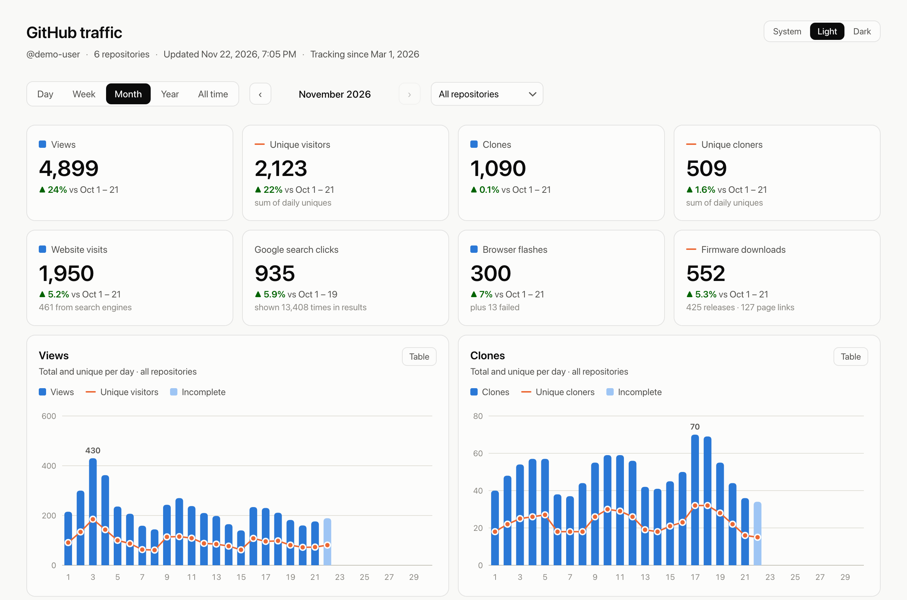

<p align="center">
  
</p>

<h1 align="center">GitHub KPIs</h1>

<p align="center">
  <b>GitHub forgets your traffic after 14 days. GitHub KPIs keeps it for good.</b><br>
  A self-hosted dashboard for views, clones, downloads, referrers and search terms across all of your repositories.
</p>

<p align="center">
  
  
  
  
  
  
  <a href="LICENSE"></a>
</p>

<p align="center">
  <picture>
    <source media="(prefers-color-scheme: dark)" srcset="assets/screenshot-dark.png">
    
  </picture>
  <br><sub>The dashboard with sample data, in light or dark mode to match your GitHub theme.</sub>
</p>

---

GitHub's Insights tab only shows the last 14 days, and then the numbers are gone.
GitHub KPIs collects them every 6 hours and builds a permanent history you can browse
by day, week, month, year or all time. Missed a few days? Each run re-fetches the whole
14-day window, so gaps fill themselves in.

## ✨ Features

- 📈 **Views and clones** for every repository, with unique visitors and cloners.
- 📦 **Release downloads per day.** GitHub only reports all-time totals, so each run
  stores them and turns the increase into daily numbers.
- ⚡ **Browser flashes** from ESP Web Tools flasher pages on GitHub Pages, which GitHub
  never counts: finished and failed flashes, plus `.bin` link clicks.
- 🔗 **Referring sites and popular content**: GitHub's top 10 per repository, saved as a
  daily snapshot so they don't disappear.
- 🌐 **GitHub Pages visits** through a tiny, cookie-free page counter.
- 🔍 **Google search terms** from Search Console (optional): clicks, impressions and
  position per page, up to 16 months back.
- 🌗 **Light and dark mode**, and % change against the previous period.

## Why you might like it

- **Zero dependencies.** `collect.py` uses only the Python standard library, and
  `dashboard.html` is a single file with no external scripts. It even opens from `file://`.
- **Privacy first.** Page pings are anonymous. Caddy logs only those requests, without
  IP addresses or headers.
- **Plays nicely with your server.** The dashboard is its own Caddy site, added with one
  `import` line. Existing sites stay untouched, and Caddy is only reloaded once no
  proxied connections (e.g. WebSockets) are open.
- **Secrets stay locked away.** Tokens are root-only on the server and handed to each run
  by systemd. On your Mac they live in the Keychain.

## 🚀 Quick start

**You need:** a Mac (the deploy script uses zsh and the Keychain), an Ubuntu server you
can reach as `root` over SSH, and a GitHub token.

1. **Create a GitHub token** at
   [github.com/settings/personal-access-tokens/new](https://github.com/settings/personal-access-tokens/new)
   with **All repositories** and **Administration: Read-only**, and store it in your Keychain:
   ```sh
   security add-generic-password -a "$USER" -s github-traffic-dashboard -w
   ```
2. **Deploy.** Set `SSH_KEY=...` (and optionally `LOGIN_USER=...`) in `deploy/server.env`
   or the environment, then:
   ```sh
   ./deploy/deploy.sh setup <server-ip> [domain] [count-domain]   # Caddy, collector, HTTPS, login
   ./deploy/deploy.sh token                                       # sends the token and collects once
   ./deploy/deploy.sh login                                       # shows the URL, user and password
   ```
   No domain? You get free HTTPS at `traffic.<ip-with-dashes>.sslip.io`. On a server that
   already runs Caddy, nothing is installed and the firewall is left alone.
3. **Add the page counter** (optional) to every page of your GitHub Pages site, then push.
   The ping endpoint is filled in from `deploy/server.env`:
   ```sh
   python3 deploy/install-counter.py <repo-name> ../<repo>/docs/index.html
   ```
   `<repo-name>` is the repository the page belongs to. New pages need the counter too.

<details>
<summary><b>Google search terms (optional)</b></summary>

Verify your Pages site in Google Search Console first. Then:

1. [Google Cloud Console](https://console.cloud.google.com/) → create a project →
   **APIs & Services → Library** → enable **Google Search Console API**.
2. **IAM & Admin → Service accounts → Create service account** (no roles), then
   **Keys → Add key → Create new key → JSON**.
3. [Search Console](https://search.google.com/search-console) → your property →
   **Settings → Users and permissions → Add user**: the service account's email,
   permission **Restricted**.
4. Run `./deploy/deploy.sh search ~/Downloads/<key>.json`, then delete the downloaded file.

</details>

## 🛠️ Day to day

```sh
./deploy/deploy.sh status      # next run, recent log, data file
./deploy/deploy.sh run         # collect right now
./deploy/deploy.sh update      # after editing collect.py or dashboard.html
./deploy/deploy.sh site        # after changing the Caddy sites in deploy.sh
./deploy/deploy.sh password    # change the login password
./deploy/deploy.sh backup      # copy traffic.json to ./backups/
./deploy/deploy.sh token       # after renewing the GitHub token (update the Keychain item first)
./deploy/deploy.sh search      # resend the Search Console key from the Keychain (e.g. new server)
./deploy/deploy.sh open | ssh  # open the dashboard / a shell on the server
./deploy/deploy.sh remove      # take the dashboard off the server (keeps the data)
```

Token expired? The dashboard shows a warning banner. Put a new token in the Keychain
and run `deploy.sh token` within 14 days, and no data is lost.

<details>
<summary><b>What goes where</b></summary>

```
collect.py                    fetches everything -> traffic.json (+ traffic.js for the page)
dashboard.html                the dashboard; reads data/traffic.js
deploy/deploy.sh              sets up and manages the server (run from your Mac)
deploy/server.env             server address, site names, SSH key, login user (written by setup, not committed)
deploy/github-traffic.*       systemd service + timer installed on the server
deploy/page-counter.html      script for the GitHub Pages pages (visits, browser flashes, .bin clicks)
deploy/install-counter.py     adds / updates that script in a page
```

| On the server | Where |
|---|---|
| Dashboard | `https://<site>/` (Caddy, Let's Encrypt, basic-auth login) |
| Ping endpoint | `https://<count-site>/` (public; receives the page counter's pings) |
| Caddy sites | `/etc/caddy/github-traffic.caddy`, pulled in by one `import` line in `/etc/caddy/Caddyfile` |
| History | `/srv/github-traffic/data/traffic.json` (nothing is ever pruned) |
| Collector | `/opt/github-traffic/collect.py`, run by `github-traffic.timer` |
| Secrets | `/etc/github-traffic/token` and `gsc-key.json` (root-only) |
| Login | `/etc/caddy/github-traffic-login.caddy` (bcrypt hash); the password is also in your Keychain |

Set `FORCE_RELOAD=1` to reload Caddy without waiting for open connections to close.

</details>

## 📊 Reading the numbers

- Days are **UTC**, the same as GitHub. Weeks run Monday to Sunday.
- **Unique visitors / cloners** are counted per day by GitHub, so period totals count
  someone who visits on 3 days 3 times.
- **Clones are mostly not people** (bots, archives, build systems). For people, look at
  views, visitors, website visits and downloads.
- **Views include your own.** In Popular content, pages marked "you" (Insights →
  Traffic) can only be opened by people with write access.
- **Firmware downloads** = release downloads + `.bin` clicks on flasher pages. Files
  downloaded straight from a repository on github.com are not counted.
- **Pings are anonymous**: ad blockers can hide some and anyone could send fake ones.
  Treat them as a good indication, not an audit.
- **Referring sites / popular content** show the last snapshot in the selected period.
- **Website visits** belong to the repository of the page (`/<Repo>/` → that
  repository; other pages → the `<user>.github.io` repository).
- **Search terms** take 2–3 days to be finalized by Google; rare searches count in the
  totals but are not listed.
- Lighter bars mark incomplete periods. Days never collected are blank, not zero, and
  the % change only appears when both periods were fully collected.

## 💻 Try it locally

```sh
python3 collect.py      # token from GITHUB_TOKEN, the Keychain, or `gh auth token`
open dashboard.html
```

This writes `data/` next to the script, which is handy for trying out changes. The real
history lives on the server.

## 🤝 Contributing

Issues and pull requests are welcome. If you add a metric, please keep `collect.py`
free of third-party packages.

## 📄 License

[MIT](LICENSE)
